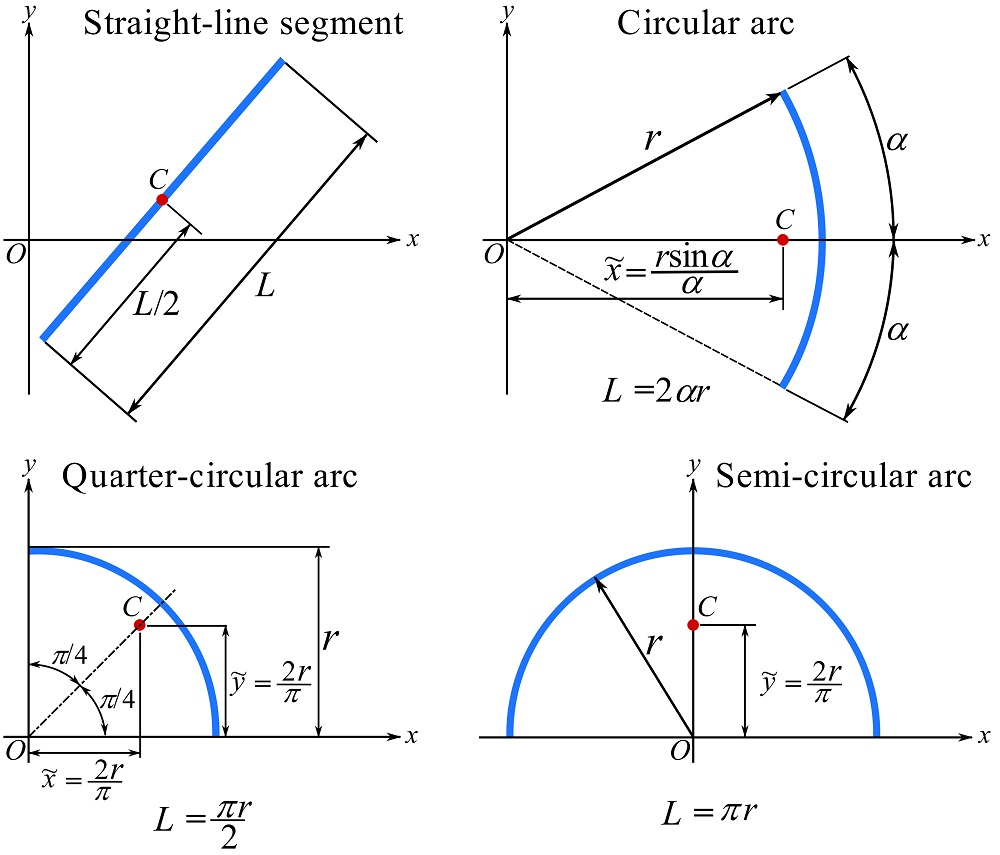
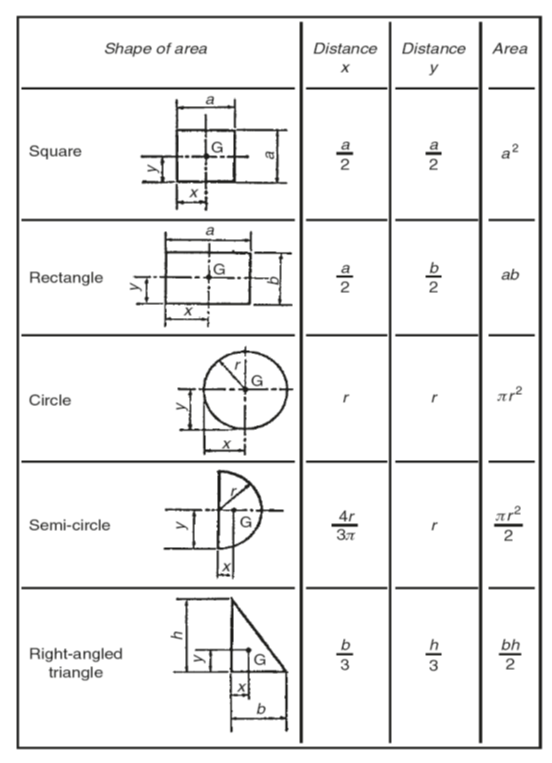
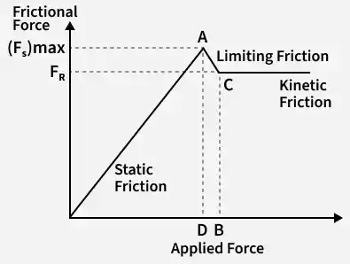

# Statics
## Force
* 4 unit : time, space, mass, force
* 3 factor : value, direction, force application point
* appearing in pairs
* Force can be transmitted through objects

## Vector & Scalar
Vector : weight, displacement, velocity
Scalar : mass, speed, time

**type of Vector**
1. free vector
1. sliding vector
1. fix vector

## Unit
* MKS : m, kg, sec
* CGS : cm, g, sec
* FPS : foot, p, sec

**force unit**

* $N = kg\cdot m/s^2$
* $Dyne = g\cdot cm/s^2$
* $poundal = lb \cdot ft/s^2$
* $kgw = kg \cdot 9.81 \cdot m/s^2$
* $gw = g \cdot 9.81 \cdot cm/s^2$
* $pound\ force = lb \cdot 32.2 \cdot ft/s^2$

## Planar force system
$$R = \sqrt{P^2+Q^2+2PQ\cos\theta}$$

$$\tan \alpha = \frac{Q\sin\theta}{P+Q\cos\theta}$$

$$\alpha = \arctan(\frac{Q\sin\theta}{P+Q\cos\theta})$$

## Moment
$$C = Fd$$

$$M = Fr$$

## Resultant force
1. When 2 forces are in the same direction, the resultant force is closer to the side with the greater force.The resultant force is greater than the sum of its parts.
1. 2 force in the opposite direction of the resultant force is closer to the side with the greater force.The resultant force is smaller than the sum of its parts.

### same point

$$F = \sqrt{(\sum F_x)^2+(\sum F_y)^2}$$

$$\theta = \arctan(\frac{\sum F_y}{\sum F_x})$$

### parallel force

$$F = \sum F_y$$

$$P(x,0)\qquad x = \frac{\sum(F_ix_i)}{F}$$

### Non-parallel and non-common points

$$F = \sqrt{(\sum F_x)^2+(\sum F_y)^2}$$

$$P(x,y)\qquad x = \frac{\sum(F_ix_i)}{F}\qquad y = \frac{\sum(F_iy_i)}{F}$$

## Diagram

| Polygon | close | open |
|:--------:|:--------:|:--------:|
| Force Polygon     | $F_{net}=0$     | $F_{net}\not=0$     |
| Funicular Polygon     | $M_{net}=0$     | $M_{net}\not=0$     |

* Lami's Theorem : $\frac{F_1}{\sin\theta_1} = \frac{F_2}{\sin\theta_2} = \frac{F_3}{\sin\theta_3}$

## Center of gravity

* A center of gravity exists only when there is a gravitational field. 
* The center of gravity does not necessarily lie within an object.

$$W\bar x = \frac{\sum w_ix_i}{\sum w_i}\qquad W\bar y = \frac{\sum w_iy_i}{\sum w_i}$$

1. Center of gravity : G
2. Center of shape : M
3. Center of mass : C

* Uniform gravitational field >> G = M
* Uniform mass >> M = C

### Line and arc

> https://engcourses-uofa.ca

### shape

> https://engineersfield.com

## Friction $f$

* $F \propto f_{max}$
* $f$ is theoretically independent of area.
* $f_k<f_{max}$
* $f_k$ is independent of speed

### Angle of friction $\theta_f$ and angle of repose $\theta_s$

$$\theta_f = \theta_s$$

$$\tan\theta_f = \tan\theta_s = \mu$$

## slope

### Uphill 

$$F = W\frac{\tan\phi+\tan\alpha}{1-\tan\phi\tan\alpha}$$

$$F = W\tan(\phi+\alpha)$$

### Downhill

$$F = W\frac{\tan\phi-\tan\alpha}{1+\tan\phi\tan\alpha}$$

$$F = W\tan(\phi-\alpha)$$
